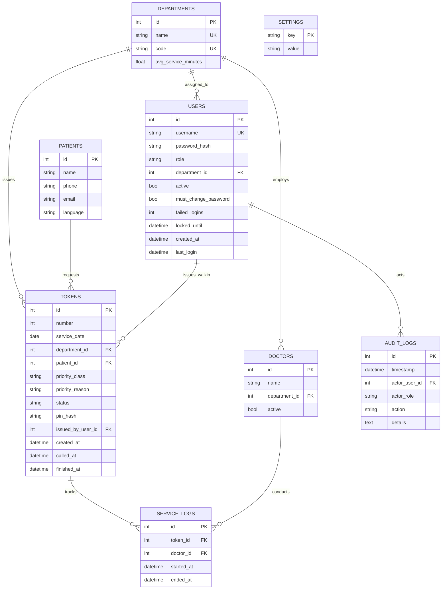

# 🏥 Baari (बारी) — Complete Web Application Features Specification

> **Tagline:** *"Come at your time, not at 4 AM."*  
> **System Name:** Baari (बारी) — Hospital OPD Queue Management System  
> **Documentation Version:** 1.0.0 (Production / Hackathon Ready)  
> **Status:** Fully Implemented & Verified (18/18 Automated Tests Passing)

---

## 📋 Executive Overview

**Baari** ("turn" in Hindi) is a lightweight, accessible, and self-hosted Out-Patient Department (OPD) queue management system designed specifically for government hospitals across India (e.g., AIIMS, Safdarjung, KEM, Civil Hospitals).

In traditional government hospital OPDs, thousands of vulnerable patients arrive between **3:00 AM and 5:00 AM** to stand in pre-dawn queues just to secure a doctor consultation token. Baari completely eliminates this pre-dawn rush by replacing chaotic first-come-first-served lines with **deterministic predicted arrival windows**, **multilingual voice kiosks (Hindi, Marathi, English)**, and **real-time queue tracking** with commute travel buffers.

---

## 🏛️ System Architecture & Technology Stack

| Layer | Technologies & Libraries | Key Highlights |
|---|---|---|
| **Backend Framework** | [FastAPI](https://fastapi.tiangolo.com/) (Python 3.11+) | Asynchronous, auto-generating OpenAPI docs, high-performance Starlette foundation |
| **Database & ORM** | SQLite in WAL (Write-Ahead Logging) mode with [SQLAlchemy 2.x](https://www.sqlalchemy.org/) | Foreign key enforcement, atomic `BEGIN IMMEDIATE` transaction locking, 8 relational tables |
| **Database Migrations** | [Alembic](https://alembic.sqlalchemy.org/) | Versioned schema migration history and stamping |
| **Authentication & Cryptography** | [Argon2id](https://github.com/hynek/argon2-cffi) via `argon2-cffi` | Password hashing and 4-digit patient PIN hashing, brute-force lockout, signed HMAC CSRF tokens |
| **Speech-to-Text (STT)** | `faster-whisper` (`Systran/faster-whisper-small` / CTranslate2 int8) + Browser Web Speech API | Offline local CPU transcription with seamless client-side browser speech recognition fallback |
| **Text-to-Speech (TTS)** | Microsoft Edge Neural TTS (`edge-tts`) + Browser Web Speech API SpeechSynthesis | High-fidelity neural voices (`hi-IN-SwaraNeural`, `mr-IN-AarohiNeural`, `en-IN-NeerjaNeural`) with LRU caching |
| **Intent & Entity Parsing** | Deterministic rule-based multilingual regex parser | Zero-cloud, instant extraction of patient names and medical department intents (Hindi, Marathi, English) |
| **Audio Synthesizer** | Web Audio API Oscillator synthesizer | Client-side three-tone hospital chime announcement (C5 523Hz → E5 659Hz → G5 784Hz) |
| **Frontend Framework** | Zero-build HTML5, Vanilla JavaScript (ES6+), CSS3 Design System | No npm/webpack/Vite required; instant load time, glassmorphism UI, light/dark/high-contrast modes |
| **Data Visualization** | [Chart.js 4.4](https://www.chartjs.org/) (vendored locally for offline use) | Interactive discrete-event simulation comparison charts |
| **QR Code Engine** | `qrcodejs` (client-side SVG/Canvas generation) + HTML5 Camera Scanner | Instant counter QR generation and browser-based camera scanning |

---

## 🌟 Comprehensive Feature Catalog

### 1. 🎫 Patient Kiosk & Public Self-Service Portal

The patient kiosk is designed for maximum accessibility, serving literate, semi-literate, and non-tech-savvy patients without requiring an app installation, smartphone ownership, or account registration.

#### 1.1 Multi-Lingual Voice Token Generator
- **Tap-to-Speak Voice Interface:** A single large microphone button activates voice input for requesting an OPD token.
- **Trilingual Speech Recognition:** Supports **Hindi (हिंदी)**, **Marathi (मराठी)**, and **English (Indian English)**.
- **Dual-Engine Speech Recognition:**
  - *Browser Web Speech API:* Instant real-time recognition on modern browsers with zero server latency.
  - *Server-Side Local Faster-Whisper:* Local CTranslate2 int8 model on CPU for offline hospital intranet setups.
  - *Strict Privacy Preservation:* Audio files sent for server transcription are immediately wiped from disk upon transcription completion (`finally: os.remove(temp_path)`).
- **Intelligent Deterministic Entity & Intent Parser:**
  - **Symptom & Department Extraction:** Parses colloquial symptom descriptions and maps them directly to the correct department:
    - *General Medicine (`G`):* "fever", "cough", "cold", "headache", "stomach", "बुखार", "खांसी", "जुकाम", "पेट दर्द", "ताप", "खोकला", "पोटदुखी".
    - *Orthopedics (`O`):* "bone", "fracture", "joint", "knee pain", "हड्डी", "जोड़", "कमर दर्द", "हाड", "सांधेदुखी", "गुडघा".
    - *Gynecology (`Y`):* "pregnancy", "period", "maternity", "women", "गर्भवती", "महिला", "स्त्री रोग", "गरोदर", "मासिक पाळी".
    - *Pediatrics (`P`):* "child", "baby", "infant", "vaccine", "बच्चा", "शिशु", "बाल रोग", "लहान मूल", "लस".
  - **Patient Name Extraction:** Recognizes conversational introductions:
    - *Hindi:* "मेरा नाम राहुल शर्मा है", "मैं अमित कुमार बोल रहा हूँ"
    - *Marathi:* "माझे नाव सचिन पाटील आहे", "मी राहुल आहे"
    - *English:* "My name is Rahul Sharma", "I am Priya Verma"
- **Interactive Visual Microphone States:** Dynamic pulse animations and color-coded status badges for Idle, Listening, and Processing.

#### 1.2 Manual Kiosk Form
- **Simple, Clear Fields:** Patient Name (required), Mobile Number (optional for SMS-ready integration).
- **Interactive Department Selection Cards:** Visual cards displaying department code (e.g. `G`, `O`, `Y`, `P`), full localized name, and real-time average service duration per patient (e.g., `~8.0 min/pt`).
- **Race-Condition-Free Token Generation:** Concurrency-safe daily token numbering via SQLite `BEGIN IMMEDIATE` transaction locking.

#### 1.3 Token Confirmation Dialog & Audio Readout
- **Hero Token Badge:** Clear display of department-prefixed token number (e.g., `G-04`, `O-02`, `Y-01`, `P-03`).
- **Secret 4-Digit Security PIN:** Cryptographically generated random 4-digit PIN stored as an `argon2id` hash. Allows patients to securely check their turn from any public or personal screen without exposing their identity.
- **Predicted Arrival Window:** Displays both the estimated wait range (e.g., `25 - 35 minutes`) and an exact recommended arrival time (e.g., `10:15 AM - 10:35 AM` or `Come now`).
- **One-Click Audio Readout:** Reads the assigned token number, department, and secret PIN aloud in the patient's selected language using Microsoft Edge Neural TTS or browser Web Speech synthesis.
- **Immediate Live Tracking Integration:** Direct button to transition into the live status tracker.

#### 1.4 Scan Hospital QR Code
- **Camera QR Scanner:** Uses `navigator.mediaDevices.getUserMedia` with rear/environment camera preference to scan physical QR codes posted at hospital entrance boards or registration desks.
- **Manual Hospital Code Entry Fallback:** Allows manual typing of hospital codes (e.g., `BAARI-GH-MUM-001`) if camera permission is denied or camera is unavailable.
- **Pre-Configured Hospital Registration Form:** Automatically resolves the hospital facility and displays a fast-track token registration form (Name, Email, Phone, Department).

#### 1.5 Live Turn Tracker & Commute Buffer Slider
- **Secure PIN Lookup:** Patients enter their Token Number and 4-digit PIN to pull up their live queue status.
- **Real-Time Polling:** Automatically queries `/api/patient/token/{id}/status` every 10 seconds to update wait times as doctors finish consultations.
- **Visual 4-Stage Journey Stepper:**
  1. *Token Issued* (Registered in system)
  2. *Rest at Home* (Ample time remaining; patient can relax at home)
  3. *Travel to OPD* (Commute window reached; patient should start journey)
  4. *In Consultation* (Called to doctor's cabin)
- **Interactive Commute Travel Buffer Slider:**
  - Adjustable slider from **5 to 90 minutes** (5 min increments).
  - Patients specify their transit time from home to the hospital.
  - Dynamically recalculates the exact "Leave home at [Time]" recommendation.
  - Automatically switches advice badge between `🏠 Stay home until [Time]` and `🏃 Come to hospital NOW!` based on whether `estimated_wait <= travel_time`.
- **Live Queue Position Badge:** Displays exact count of people ahead in the department queue (e.g. `3 people ahead of you`).
- **Audio & Visual Call Alerts:** When a patient's status transitions from `waiting` to `called`, the tracker automatically plays the 3-tone hospital chime and speaks an audio announcement instructing them to proceed to the doctor's cabin.

---

### 2. 📋 Staff Queue Management Console

The Staff Console gives OPD nurses, desk attendants, and doctors complete control over queue progression with strict department isolation.

#### 2.1 Department Isolation & Role-Based Access Control (RBAC)
- **Department Locking:** Staff user accounts are strictly bound to a single department in the database (`user.department_id`).
- **Server-Side Enforcement:** Backend endpoints verify that staff can only view, call, complete, or modify tokens in their assigned department (`HTTP 403 Forbidden` if attempting cross-department access).
- **Admin Multi-Department Switcher:** Administrator accounts have an active dropdown to inspect and manage any department queue on the fly.

#### 2.2 Live Queue Board
- **Real-Time Queue Table:** Auto-refreshes every 8 seconds with live token statuses.
- **Deterministic Multi-Tier Queue Sorting:**
  1. *Emergency* (First-In, First-Out)
  2. *Priority* (Elderly, pregnant, disabled — FIFO)
  3. *Normal* (Standard queue — FIFO)
- **Privacy Phone Masking:** Phone numbers are masked on staff screens (e.g. `••••••7890`), showing only the last 4 digits.
- **Location Status Indicators:** Distinct badges indicate whether a patient is estimated to be `🏠 At home` or `📍 In Hall` based on their arrival buffer.
- **Wait Time Predictions:** Real-time calculation of remaining wait time for every individual queued token.

#### 2.3 Consultation Flow & Queue Progression
- **"📢 Call Next Patient" Action:**
  - Atomically fetches the highest-priority waiting patient.
  - Transitions token status from `waiting` to `called`.
  - Automatically creates a `ServiceLog` record timestamping the consultation start time and assigning the active doctor.
  - Triggers the browser-synthesized 3-tone hospital chime.
  - Broadcasts a speech announcement (e.g., *"Token number G-04, Ramesh Kumar, please proceed to the doctor cabin"*).
- **"✓ Done" (Visit Completed):**
  - Marks the token as `done` and timestamps `finished_at`.
  - Calculates the exact duration of the consultation in minutes.
  - Updates the department's Exponential Moving Average (EMA) service duration in real-time.
- **"No-Show" Handling:**
  - Marks called patients who failed to appear as `no_show`.
  - Closes active service log without distorting the doctor's average service duration.
  - Frees up the counter immediately for the next patient.

#### 2.4 Dynamic Capacity Surge Recommendation
- **Overload Detection Algorithm:** Compares current waiting queue size against active doctor capacity.
- **Actionable Counter Alert:** When waiting queue backlog exceeds operational thresholds, a prominent banner alerts staff:
  > *"⚠️ High Queue Congestion: High Queue Load (12 waiting). Activating an additional doctor counter can save ~4.5 minutes per patient."*
- **Quantified Time Savings:** Calculates the exact estimated time savings per patient if an idle doctor counter is brought online.

#### 2.5 Walk-in Token Generation at Desk
- **Assisted Walk-in Modal:** Staff can generate tokens for illiterate, elderly, or emergency patients arriving directly at the desk.
- **Priority Classification:**
  - `normal` — Standard queue
  - `priority` — Elderly, pregnant women, patients with mobility challenges
  - `emergency` — Severe trauma, acute distress
- **Mandatory Justification for Overrides:** System enforces that staff provide a clinical reason whenever assigning `priority` or `emergency` status.

#### 2.6 Priority Override Modal
- **In-Line Priority Re-Classification:** Staff can change the priority class of any waiting patient directly from the queue table.
- **Mandatory Reason & Audit Log:** Every priority modification requires clinical justification and is committed to the immutable audit log.

#### 2.7 Doctor Availability & Roster Management
- **Department Doctor Roster:** Displays all doctors registered in the department.
- **Instant Availability Toggle:** 1-click toggle between `Active` (consulting in OPD) and `Away` (on rounds, surgery, or break).
- **Immediate Queue Recalculation:** Toggling a doctor's status instantly recomputes estimated wait times and arrival windows for all waiting patients in that department.

#### 2.8 Staff Performance KPI Tiles
- **Active Doctors Counter:** Displays active vs. total registered doctors (e.g. `2 / 2`).
- **Waiting Patients Count:** Number of uncalled patients remaining.
- **In Cabin Count:** Patients currently inside consultation rooms.
- **Done Today Count:** Total consultations successfully completed today.
- **Dynamic Average Service Time:** Running Exponential Moving Average (EMA) of consultation duration (e.g. `8.2 min`).

---

### 3. 📊 OPD Crowd & Wait Simulator

An interactive, in-browser discrete-event simulation model designed for hospital superintendents, health ministry officials, and hackathon judges to mathematically demonstrate how Baari slashes waiting hall congestion by over 70%.

#### 3.1 Simulation Engine (`app/simulation.py`)
- **Baseline Model (Without Baari — Pre-Dawn Rush):**
  - Simulates 75% of patients arriving between **4:00 AM and 7:30 AM** before OPD doors open at 8:00 AM.
  - Simulates remaining 25% arriving between 7:45 AM and 11:00 AM.
  - Calculates massive patient crowd buildup standing in halls waiting for the 8:00 AM shift start.
- **Baari Model (Staggered Arrival Windows):**
  - Staggers patient arrival times based on algorithmic slot predictions.
  - Simulates compliant patients arriving only **15 minutes before their scheduled turn**.
  - Models realistic non-compliant behavior (patients who still choose to arrive early out of habit) based on adherence rate.
- **Gaussian Consultation Variation:** Doctor consultation times are modeled using Gaussian distribution ($\mu = 8.0\text{ min}, \sigma = 2.5\text{ min}$, bounded between 3 and 20 min).
- **Deterministic Random Seed:** Ensures 100% reproducible test runs given the same seed parameter (`seed=42`).

#### 3.2 Interactive Parameter Sliders
- **Patients per Day:** Slider from **20 to 300 patients** (default: 100).
- **Doctor Counters:** Slider from **1 to 8 active doctors** (default: 3).
- **Baari Adherence Rate:** Slider from **10% to 100%** (default: 75%).

#### 3.3 Comparative Visualization & Impact Metrics
- **Dual-Curve Chart.js Graph:**
  - *Red Area Curve:* Baseline pre-dawn crowd accumulation (shows dangerous peak crowding exceeding 70+ people in hall).
  - *Green Area Curve:* Baari staggered crowd curve (smooth, flat, safe density rarely exceeding 8-12 people).
- **Quantified Impact KPI Cards:**
  - **Wait Reduction:** Shows percentage drop in physical waiting hall time (e.g., `-74.2%` — dropped from 145m to 37m in hall).
  - **Peak Crowd Cut:** Shows percentage drop in maximum hall congestion (e.g., `-77.1%` — peak reduced from 70 to 16 patients).
  - **Total Hours Saved:** Total unproductive patient waiting hours eliminated per day (e.g., `180.5 hrs saved`).

---

### 4. ⚙️ Admin Control Center

Comprehensive administrative suite for hospital administrators and IT officers to oversee hospital operations, security, and staffing.

#### 4.1 Hospital QR Code Generator
- **Kiosk & Counter QR Code Generator:** Generates unique, scannable QR codes for hospital kiosks, reception stands, and OPD entrance flyers.
- **Configurable Hospital Metadata:** Admin can set the Hospital Name (e.g., *"District Government Hospital"*) and Unique Registration Code (e.g., `BAARI-GH-MUM-001`).
- **Client-Side Vector QR Generation:** Uses `qrcodejs` to render high-resolution QR codes directly in the browser.

#### 4.2 Daily OPD Summary & Operational KPIs
- **Aggregated Today's Metrics:**
  - *Patients Served:* Total completed consultations across all departments today.
  - *Average Wait Time:* Overall hospital average wait time in minutes.
  - *Longest Wait Time:* Peak individual wait time recorded today.
  - *Peak Hour Calculation:* Automatically identifies the hospital's busiest hour (e.g., `09:00 AM`).
  - *No-Show Rate:* Total no-shows and exact percentage of total tokens issued.
- **Per-Department Real-Time Breakdown Cards:**
  - Department Name and Code (e.g., `General Medicine (G)`).
  - Total tokens registered today.
  - Tri-column breakdown: **Waiting**, **Done**, and **No-Show** counts.
  - Real-time department EMA consultation duration.

#### 4.3 Staff User & Account Management
- **Staff Accounts Table:** Displays Username, Role (`admin` / `staff`), Department assignment, Account Status (`Active` / `Disabled`), and Last Login timestamp.
- **Add Staff Account Modal:** Create new staff credentials with username pattern enforcement (`^[a-zA-Z0-9_]+$`), minimum 8-character password, role selection, and department assignment.
- **1-Click Account Toggle:** Enable or disable user accounts immediately. Self-disabling of the logged-in admin account is strictly prevented.
- **Password Reset Modal:** Admin can reset any staff member's password, unlock locked accounts, and enforce password change on next login.

#### 4.4 Security Audit Log Viewer
- **Immutable Security Audit Trail:** Real-time log table tracking every sensitive action across the system.
- **Logged Attributes:** Timestamp, Action Name, Actor Username/Role, and JSON details payload.
- **Tracked Security & Operational Events:**
  - `token_issued` (Kiosk & self-service tokens)
  - `walk_in_issued` (Staff-assisted desk tokens)
  - `token_called` (Call next patient)
  - `token_done` (Consultation completed with consultation duration & EMA update)
  - `token_no_show` (Patient marked no-show)
  - `priority_changed` (Priority upgrades/downgrades with mandatory clinical reasons)
  - `doctor_status_toggled` (Doctor active/away status changes)
  - `account_created` (New staff or admin registered)
  - `user_status_toggled` (Account enabled/disabled)
  - `password_reset_by_admin` (Admin password resets)
  - `failed_login` (Failed login attempts, account lockouts, disabled user attempts)
  - `queue_reset` (Demo queue reset events)
- **Pagination & Filtering:** Filter logs by action type or actor role with configurable page sizes.

#### 4.5 Demo Queue Reset Action
- **1-Click Reset ("⚠️ Reset Queue"):** Clears all tokens and service logs for the current date so hospital evaluators and hackathon judges can re-test workflows from a clean slate without restarting the server.
- **Audit-Logged:** Every reset action is recorded in the immutable audit log with the count of cleared tokens.

---

### 5. 🤖 Multilingual Voice & AI Core (Offline & Local)

Baari's AI capabilities are designed with a **privacy-first, offline-first philosophy** suitable for remote district hospitals with unreliable internet access.

| Feature | Capabilities |
|---|---|
| **Supported Languages** | **Hindi (हिंदी)**, **Marathi (मराठी)**, **English (Indian English)**; easily extensible to Tamil, Telugu, Bengali |
| **Speech-to-Text (STT)** | 1. Local `faster-whisper` (`small` model) using CTranslate2 int8 quantization on standard CPU.<br>2. Browser Web Speech API (`webkitSpeechRecognition`) for zero-latency client recognition.<br>3. Instant audio file deletion after transcription for patient data privacy. |
| **Text-to-Speech (TTS)** | 1. Microsoft Edge Neural TTS with natural regional accents (`hi-IN-SwaraNeural`, `mr-IN-AarohiNeural`, `en-IN-NeerjaNeural`).<br>2. Dual-tier caching (In-Memory dictionary + disk cache) for near-instant repeat synthesis.<br>3. Client-side browser `SpeechSynthesisUtterance` fallback with Google Indian voice prioritization. |
| **Natural Intent Parsing** | Deterministic keyword and regex parser mapping colloquial terms and symptom descriptions to departments without cloud LLM dependencies. |
| **Audio Chime Synthesizer** | Pure Web Audio API sine-wave synthesizer creating an authentic 3-tone hospital chime (`523.25 Hz` → `659.25 Hz` → `783.99 Hz`) without external MP3 files. |

---

### 6. 🧮 Queue Logic & Exponential Moving Average (EMA) Engine

The algorithmic core of Baari ensures deterministic fairness and dynamically self-corrects based on doctor speed.

#### 6.1 Deterministic Queue Ordering
Waiting tokens are sorted using a multi-key tuple:
$$\text{Priority Weight} \in \{\text{Emergency}: 0, \text{Priority}: 1, \text{Normal}: 2\} \quad \longrightarrow \quad \text{Created Timestamp (FIFO)}$$
- An emergency patient always jumps ahead of all priority and normal patients.
- Within the same priority tier, strict First-In, First-Out (FIFO) ordering is guaranteed.

#### 6.2 Predicted Arrival Window Formula
For patient at position $P$ in queue (1-indexed):
$$\text{Estimated Wait (minutes)} = \frac{(P - 1) \times \text{Average Service Minutes}}{\text{Active Doctors Count}}$$
- **Arrival Time Range:** $[\text{Wait} - 5\text{ min}, \text{Wait} + 5\text{ min}]$.
- **"Come Now" Threshold:** If $\text{Estimated Wait} \le \text{Arrival Buffer (15 min)}$, the system immediately instructs the patient to report to the hospital waiting hall.

#### 6.3 Exponential Moving Average (EMA) Service Duration Updates
Rather than assuming a static consultation time, Baari continuously learns doctor consultation speed throughout the day using Exponential Smoothing:
$$\text{EMA}_{t} = \alpha \times \text{Duration}_{\text{actual}} + (1 - \alpha) \times \text{EMA}_{t-1}$$
- Smoothing factor: $\alpha = 0.2$
- Constrained between reasonable bounds ($3.0\text{ min} \le \text{EMA} \le 30.0\text{ min}$).
- When a doctor spends longer with complex cases, subsequent patient arrival times automatically push back, preventing waiting room crowding.

---

### 7. 🔒 Security, Authentication & Session Architecture

Baari adheres to enterprise and healthcare security standards:

- **Argon2id Cryptography:**
  - User passwords hashed with `Argon2id` (memory-hard, resistant to GPU/ASIC attacks).
  - 4-digit patient PINs hashed with `Argon2id` (prevents rainbow table attacks on small PIN keyspace).
- **Brute-Force & Lockout Protection:**
  - Tracks failed login attempts per user.
  - Automatically locks accounts after **5 failed attempts** for **15 minutes**.
  - Returns identical generic error messages (`"Invalid username or password"`) for both incorrect username and incorrect password to prevent user enumeration.
- **Session Security & CSRF Defense:**
  - Secure, signed `HttpOnly` session cookies (`baari_session`) preventing XSS token theft.
  - HMAC-signed CSRF tokens (`X-CSRF-Token`) validated on all mutating HTTP requests (`POST`, `PUT`, `DELETE`).
- **Comprehensive HTTP Security Headers:**
  - `Content-Security-Policy (CSP)`: Restricts script, style, and font sources; blocks clickjacking.
  - `X-Frame-Options: DENY`: Blocks iframe embedding.
  - `X-Content-Type-Options: nosniff`: Prevents MIME-type sniffing.
  - `X-XSS-Protection: 1; mode=block`: Legacy browser XSS protection.
  - `Referrer-Policy: strict-origin-when-cross-origin`.
  - `Permissions-Policy: camera=(self), microphone=(self), geolocation=()`.
- **Patient Privacy by Design:**
  - No electronic health records (EHR) or diagnostic notes stored on disk.
  - Minimal identity footprint: Name and optional masked phone number.
  - Temporary audio recordings deleted immediately after transcription.

---

### 8. 🎨 UI Design, Accessibility & Theming

Designed following modern web standards with rich aesthetics, smooth animations, and high accessibility:

- **Zero-Build Architecture:** Runs directly from static files served by FastAPI; no Node.js compilation required in deployment.
- **Trilingual i18n Switcher:** Instant switching between English, Hindi, and Marathi across all UI headings, buttons, badges, and modals without page reload.
- **Glassmorphism Design System:** Clean, modern translucent panels, sleek dark mode color palettes, and ambient floating particles background.
- **High-Contrast Mode (`👁️`):** 1-click toggle for patients and staff with visual impairments (high-contrast borders, solid black backgrounds, bright yellow/white text).
- **Light/Dark Theme Switcher (`🌓`):** Persistent theme toggle stored in browser `localStorage`.
- **Native HTML5 Dialogs:** Accessible `<dialog>` elements for login, walk-in token issuance, priority modification, and admin accounts.
- **Non-Intrusive Toast Notifications:** Self-dismissing toast notifications for immediate user feedback on success, warnings, or errors.
- **Quick Demo Login Bar:** Top-level pills for 1-click credential prefill for evaluator convenience:
  - 👑 *Admin* (`admin` / `BaariAdmin@2024`)
  - 🩺 *Staff: General Med* (`staff_g` / `StaffPass@2024`)
  - 🦴 *Staff: Ortho* (`staff_o` / `StaffPass@2024`)
  - 🔑 *Patient Demo PIN:* `1234`

---

## 👥 Role-Based Feature Matrix

| Feature / Capability | Public Patient | Staff Member | Hospital Admin |
|---|:---:|:---:|:---:|
| **Request Token via Voice (HI/MR/EN)** | ✅ | ✅ | ✅ |
| **Request Token via Manual Form** | ✅ | ✅ | ✅ |
| **Scan Counter QR Code to Register** | ✅ | ✅ | ✅ |
| **Lookup Live Status with Token + PIN** | ✅ | ✅ | ✅ |
| **Adjust Commute Travel Buffer Slider** | ✅ | ✅ | ✅ |
| **Receive Turn Audio & Chime Alerts** | ✅ | ✅ | ✅ |
| **View Live Department Queue Board** | ❌ | ✅ (Own Dept) | ✅ (All Depts) |
| **Call Next Patient ("Call Next")** | ❌ | ✅ (Own Dept) | ✅ (All Depts) |
| **Complete Visit ("Done") & Update EMA** | ❌ | ✅ (Own Dept) | ✅ (All Depts) |
| **Mark Patient as No-Show** | ❌ | ✅ (Own Dept) | ✅ (All Depts) |
| **Issue Desk Walk-in Token** | ❌ | ✅ (Own Dept) | ✅ (All Depts) |
| **Override Token Priority (with Reason)**| ❌ | ✅ (Own Dept) | ✅ (All Depts) |
| **Toggle Doctor Availability (Active/Away)**| ❌ | ✅ (Own Dept) | ✅ (All Depts) |
| **Receive High Queue Congestion Surge Alerts**| ❌ | ✅ | ✅ |
| **Run Discrete-Event OPD Simulation** | ❌ | ✅ | ✅ |
| **Generate Hospital Counter QR Codes** | ❌ | ❌ | ✅ |
| **View Hospital Daily KPIs & Department Cards**| ❌ | ❌ | ✅ |
| **Create & Toggle Staff Accounts** | ❌ | ❌ | ✅ |
| **Reset Staff Passwords** | ❌ | ❌ | ✅ |
| **Inspect Immutable Security Audit Logs** | ❌ | ❌ | ✅ |
| **Execute 1-Click Demo Queue Reset** | ❌ | ❌ | ✅ |

---

## 🛣️ Complete Backend API Endpoint Specification

### 1. Authentication Endpoints (`/api`)
- `POST /api/login`: Authenticate with username and password. Sets `HttpOnly` session cookie and `X-CSRF-Token` header.
- `POST /api/logout`: Terminate session and invalidate cookie.
- `GET /api/me`: Returns current authenticated user information and department binding.
- `POST /api/change-password`: Self-service password change for logged-in users.

### 2. Patient Endpoints (`/api/patient`)
- `GET /api/patient/departments`: List all active hospital departments.
- `POST /api/patient/token/request`: Issue a new self-service or kiosk token with predicted arrival time and PIN.
- `GET /api/patient/token/{token_id}/status`: Live polling endpoint for token queue position and arrival advice.
- `POST /api/patient/token/lookup`: Lookup token status using Token Number (`G-04`) and 4-digit PIN.
- `POST /api/patient/voice/parse-intent`: Parse natural text in Hindi/Marathi/English into department intent and patient name.
- `POST /api/patient/voice/transcribe`: Transcribe uploaded audio using local faster-whisper and extract entities.
- `GET /api/patient/voice/tts` (and `/api/voice/tts`): Stream high-fidelity neural MP3 speech audio.

### 3. Staff Queue Endpoints (`/api/staff`)
- `GET /api/staff/queue`: Fetch live queue board, doctors, capacity surge alerts, and waiting tokens for department.
- `POST /api/staff/call-next`: Atomically call the next highest-priority waiting patient; starts service log.
- `POST /api/staff/token/{token_id}/done`: Complete consultation, calculate duration, and update department EMA.
- `POST /api/staff/token/{token_id}/no-show`: Mark patient as no-show and free counter.
- `POST /api/staff/issue-token`: Issue walk-in desk token with optional priority class and mandatory reason.
- `PUT /api/staff/token/{token_id}/priority`: Update priority class (`normal`, `priority`, `emergency`) with justification.
- `GET /api/staff/doctors`: List registered doctors in the active department.
- `POST /api/staff/doctors/{doctor_id}/toggle`: Toggle doctor availability (`active` vs. `away`).

### 4. Simulation Endpoints (`/api/simulation`)
- `POST /api/simulation/run`: Execute discrete-event simulation comparing baseline 4 AM rush against Baari.

### 5. Admin Endpoints (`/api/admin`)
- `GET /api/admin/summary`: Aggregated daily hospital report (served, avg wait, peak hour, no-show rate, by department).
- `GET /api/admin/users`: List all staff and administrator accounts.
- `POST /api/admin/users`: Create new staff or admin user account.
- `POST /api/admin/users/{user_id}/toggle`: Enable or disable user account.
- `POST /api/admin/users/{user_id}/reset-password`: Reset user password and force change on next login.
- `GET /api/admin/departments`: List hospital departments.
- `POST /api/admin/departments`: Create a new hospital department.
- `GET /api/admin/doctors`: List all doctors across all hospital departments.
- `POST /api/admin/doctors`: Add a new doctor to a department.
- `GET /api/admin/audit`: Fetch security audit logs with filtering and pagination.
- `POST /api/admin/reset-day`: Convenience demo endpoint to wipe today's tokens and service logs for fresh evaluation.

---

## 🗄️ Relational Database Schema (8 Tables)



---

## 🔑 Ready-to-Test Demo Accounts

The database comes pre-seeded with realistic data, active departments, doctors, and demo staff accounts:

| Role | Username | Password | Assigned Department | Purpose |
|---|---|---|---|---|
| **Administrator** | `admin` | `BaariAdmin@2024` | *All Departments* | Full hospital administration, QR code generation, KPIs, audit log, account creation |
| **Staff (General Medicine)** | `staff_g` | `StaffPass@2024` | General Medicine (`G`) | General Medicine OPD queue management, calling patients, toggling doctors |
| **Staff (Orthopedics)** | `staff_o` | `StaffPass@2024` | Orthopedics (`O`) | Orthopedics OPD queue management |
| **Staff (Gynecology)** | `staff_y` | `StaffPass@2024` | Gynecology (`Y`) | Gynecology & Maternity OPD queue management |
| **Staff (Pediatrics)** | `staff_p` | `StaffPass@2024` | Pediatrics (`P`) | Pediatrics OPD queue management |
| **Patient Demo PIN** | *Token e.g.* `G-04` | `1234` | — | Test live patient lookup in tracker |

---

## 🛠️ Maintenance & Automated Testing

### Running the Test Suite
Baari includes a comprehensive automated test suite verifying all core algorithms and security policies:
```bash
pytest -v
```
**Test Coverage Includes:**
- Queue sorting and multi-tier priority handling (Emergency > Priority > Normal).
- Predicted wait time calculations and "Come now" thresholds.
- Dynamic Exponential Moving Average (EMA) consultation duration updates.
- Argon2id password security, PIN verification, brute-force lockout, and CSRF token enforcement.
- Discrete-event simulation mathematical reproducibility and crowd reduction verification.

### Database Snapshot & Backup
Create an atomic, timestamped backup snapshot of the SQLite database:
```bash
python3 -m scripts.backup
```
Snapshots are written with SHA-256 integrity verification to the `backups/` directory.

---
*Document prepared for Hacktoberfest '26 Hack Day & Production Deployment.*
